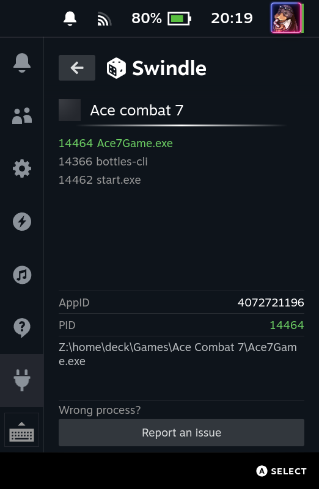

# Swindle

A high-performance memory scanning plugin for the Steam Deck, where you never have to guess the type of a value.

> **Swindle is based on [Reroll](https://github.com/kayon/decky-reroll) by [Kayon](https://github.com/kayon)**, itself inspired by [Memory Deck](https://github.com/CameronRedmore/memory-deck). This project is a fork/derivative work and, like the original, is licensed under the **GNU GPL v3**. Full credit for the original plugin and its scanning engine ([memscan](https://github.com/kayon/memscan), now forked) goes to Kayon.


*Swindle on the Steam Deck: the three colored lines are the three searches, `Int8` is the type that holds the value (5 results), and the green roller writes a value over the results.*

## Why Swindle?
In a memory scanner you have to choose the type of the value (8, 16, 32 or 64-bit integer, 32 or 64-bit float) **before** searching, which is exactly what you do not know. Swindle removes that first guess: it searches the value in **every type that can hold it, at once**, shows what each type found, and lets you drop the types that turn out to be wrong.

It keeps what made Reroll good: a very fast engine, automatic detection of the running game, and an interface built for the controller.

## Key Features
- 🔎 **Every type at once**: type a value, and it is searched as Int8, Int16, Int32, Int64, Float32 and Float64 in a single pass over the game memory, for every type that can hold it (1000 does not fit an Int8, 3.5 is a float). The memory is read only once, so searching six types is far cheaper than six separate scans.
- 🚀 **Ultra-Fast Scanning**: Millisecond-level scanning, powered by [memscan](backend/memscan) (a fork of [kayon/memscan](https://github.com/kayon/memscan), kept in this repository), a high-performance engine custom-built for the Steam Deck.
- 🎯 **Smart Process Identification**: Automatically detects the currently active game—eliminating the need to scroll through messy process lists or risk selecting the wrong target.
- 🗂️ **Three searches side by side**: look for your ammo, your health and something else at the same time. A strip of three colored lines under the game name shows which of the three you are on, and `L1` / `R1` switch between them instantly: nothing is reloaded, each search keeps its value, its results and its locked values.
- ➖ **Negative values** can be searched and written.
- 🔒 **Value freezing** (lock): keep a value fixed in memory, for one result or for all of them. Locks stay active while you look at another search. *The freezing feature was written by [EcthorSilva](https://github.com/EcthorSilva) ([Reroll pull request 6](https://github.com/kayon/decky-reroll/pull/6)); see [Credits](#credits).*
- 📉 **Gradient**: write a different value on each result (87, 86, 85...) to find out which address does what in the game.
- 🕹️ **Made for the controller**: every action has a button, and the legend at the bottom tells which.
- 📱 **Compact Interface**: A streamlined UI optimized for handheld play. The panel scrolls vertically.
- 🪶 **Light on memory**: three large searches of several million results each took about 330 MB (peak 342 MB) in the plugin on a Steam Deck with a game running (Ace Combat 7 under Bottles), with no swap used and 8.6 GB of the 14.8 GB still available. An address costs 8 bytes; each search keeps at most 64 million of them.

## How to use it
1. **Type the value** with the value selector (the roller): up/down changes a digit, left/right moves. The first slot is the sign (`+` / `-`), and a decimal point can be placed among the digits.
2. **See which types will be searched.** Under the roller, a chip per type shows what applies to the value you typed (the others are struck out). Touch or select a chip to force a choice of types (*Manual*); *Auto* goes back to the detection.
3. **First Scan.** Each searched type gets a chip with the number of results it found. Select a chip to list the results of that type.
4. **Change the value in the game, type the new value, Next Scan.** Only the results that follow the change survive; the types where nothing is left are struck out. Repeat until few results remain.
5. **Keep only the right type.** Once you know which type holds the value, press `Y` on its chip: the other types are dropped (struck out with a dash). *Undo* brings them back until the next scan.
6. **Change the value** of a result (`A` on its line), of all of them, or **lock** it so that it stays fixed.
7. **Tell the addresses apart** with a gradient (`L4`, or the *Gradient* button): the first result gets the value of the green roller, the next ones one less each. Change a value in the game and you see which address it belongs to.
8. **Look for something else** with `L1` / `R1`: they go to the previous / next of the three searches (from the last to the first and back). The line of the search you are on is bright, the lines of searches that hold results are dimmer, and the ones that are still empty are the palest. *Reset* only forgets the search you are on.

About the gradient: the sign of the value is never changed, so that the game does not get something it does not expect. A positive value goes down by 1 on each result and stops at 0. A negative value goes down by 1 too, away from zero, and stops at the smallest number of the type (-128 for an Int8). Decimals use the same step of 1, and a value of 0 gives no gradient.

What a type chip tells:

| Chip | Meaning |
| --- | --- |
| `Int32 12` | 12 results, listed when they are few |
| `Int16 4.2M` (orange) | too many results to list; they are kept and a next scan can still narrow them down |
| `Float32 !` | too many results to keep: the type was dropped |
| `Float64 0` (struck out) | nothing left for this type |
| `Int64 –` (struck out) | dropped: the value you typed cannot be expressed in this type, or you chose *keep only* |

A few things worth knowing:
- The same memory can be read as several types: a 32-bit number followed by zeros is also a 64-bit number, so an address may appear in more than one type.
- Positive numbers are shown as you typed them (3000000000 is not shown as a negative Int32).
- Int8 and Int16 hit often: a small value such as 100 gives many results in these types, which is why *keep only* and the next scan matter.

## Controls

**Everywhere in the panel**

| Button | Action |
| --- | --- |
| `R2` | Starts the scan that is available: the first scan, or the next one when there are results to narrow down. Works from the search roller, the type chips and the scan buttons; it does nothing from the part that changes values (below), so that a scan is never started by mistake there. From the search roller it also ends the editing, since you go back to the game to change the value. |
| `L1` / `R1` | Previous / next of the three searches. Not while a scan is running. |

**Search roller** (the one at the top)

| Button | Action |
| --- | --- |
| `A` | Edit the value |
| `◀ ▶` / `▲ ▼` | Move between digits / change the digit (on the sign slot: `+` / `-`) |
| `A` / `Y` while editing | Set the digit under the cursor to 0 / to 9 (sign slot: `+` / `-`) |
| `X` while editing | Reset the value |
| `B` | Leave the editing |

**Type chips**

| Button | Action |
| --- | --- |
| `A` | Before a scan: force or release a type. After: list the results of this type |
| `Y` | Keep only this type (offered when it has results and another type still has some) |

**What changes values** (the header with *Found / Lock / Change all*, the green value roller, the list of results)

| Button | Action |
| --- | --- |
| `◀ ▶` | Previous / next page of results (only when there is more than one page) |
| `▲ ▼` | Move between results |
| `A` on a result | Write the value of the green roller there |
| `X` on a result | Lock / unlock this result |
| `X` on the green roller | Lock all the results, or unlock them all as soon as one is locked |
| `L2` on the green roller | Write the value over all the results, also while editing it |
| `L4` on the green roller | Write a gradient: the value on the first result, one less on each of the next ones (also while editing; the *Gradient* button in the header does the same) |

The green roller has a sign slot like the search roller (`+` / `-`, with `▲ ▼` on it), and checks the value against the range of the type listed: an Int8 takes -128 to 255, an Int16 -32768 to 65535, and so on. A positive number is written as an unsigned number, a negative one as a signed number.

The **Settings** (cog) tune the number of results shown (up to 100), how floats are compared (unrounded, rounded to the nearest, extreme, truncated), and the *Emulator games* mode, which scans every memory region, read-only and shared ones included (Yuzu, Ryujinx...). The emulator mode was written by [maosasagawa](https://github.com/maosasagawa) ([Reroll pull request 9](https://github.com/kayon/decky-reroll/pull/9) and [memscan pull request 3](https://github.com/kayon/memscan/pull/3)); see [Credits](#credits).

## What's New
### Unreleased (backend core: v0.5.0)
* **Three searches side by side**, switched with `L1` / `R1` without reloading anything. Each one is an independent search in the engine; locks work on all of them at once.
* **Gradient** (`L4`): a different value on each result, to find which address does what.
* **Negative values when writing**, with the range of each type checked.
* **Messages for the types that cannot be listed**: too many results to list (change the value in the game, then scan again) and too many results to keep.
* **Multi-type search**: the value is searched in every type that can hold it, in one pass. Types are shown as chips; *Keep only* drops the others.
* **Negative values** in the search.
* **Value freezing** and **emulator games mode**, which are not the work of this project's author: they come from pull requests that were proposed to Reroll and memscan and are still open there. See [Credits](#credits).
* **Controller shortcuts**: `R2` starts a scan, `X` / `L2` lock all and change all, `Y` keeps one type. A legend in English whatever the language of Steam.
* **The panel scrolls vertically**, and the interface no longer turns forever when the backend does not answer: it gives up after 60 seconds.
* **Fixed a scan that never ended**: reading or writing a one-byte value at an address that had become unreadable (a page freed by the game) made the engine loop forever. The bug comes from the original engine and only showed with Int8; the engine now has tests for it.

### v0.2.0 of Reroll (backend core: v0.3.0)
* **NextScan Optimization**: For datasets exceeding 10 million results, `NextScan` latency was reduced from seconds to milliseconds.
* **Ordered Results**: Search results are displayed in ascending order.
* **Undo Support**: Undo Scan reverts the previous scan operation.

## Installation
Swindle is **not published yet** on the Decky Store, and no release is available for now. Install a zip you built yourself (see *Building from source* below), with [Decky Loader](https://github.com/SteamDeckHomebrew/decky-loader) installed:
1. Open **Settings** in the Decky Loader menu and enable **Developer Mode**.
2. Go to the **Developer** tab.
3. Copy `Swindle.zip` to your Steam Deck, then click **Install Plugin from Zip** and select it.

Once a release is published, the zip will also be installable from the [Releases](https://github.com/naparuba/decky-swindle/releases) page, with **Install via URL**:
```text
https://github.com/naparuba/decky-swindle/releases/latest/download/Swindle.zip
```

## Building from source
The frontend is TypeScript (React, `@decky/ui`), the backend is Python around [memscan](backend/memscan), the Go scanning engine, which lives in this repository with its own history, license and authors.

- **Frontend only** (type-checking and bundle in `dist/`): `pnpm install`, then `pnpm run build`.
- **Tests of the logic** (which types a value can be searched in, shortcuts, timeouts...): `pnpm test`. It needs nothing more than the project dependencies.
- **Full plugin zip** (`out/Swindle.zip`), on Linux with Docker: `make SHELL=/bin/bash setup` once (it downloads the Decky CLI), then `sudo ./cli/decky plugin build .`. The build runs in the Decky builder container; [backend/entrypoint.sh](backend/entrypoint.sh) compiles `memscan.so` from [backend/memscan](backend/memscan), so the plugin and the engine always come from the same commit (the Go toolchain is downloaded by the build when needed, so it needs network access). On Windows, use WSL2 or a Linux virtual machine.
- **Deploy to a Steam Deck**: `make deploy` / `make deploy-ui` (they need a `.env` file with `DECK_HOST` and `DECK_PWD`), or copy the zip and install it as above.

## Why does this plugin require root privileges?
`Proton` games usually do not require `root` privileges to access memory because `Proton` runs as the `deck` user.

However, for native Linux games, `root` is mandatory.

## 💡 No results? Try selecting the process manually

**A quick tip on the Auto-Select logic:**

If you find that your searches aren't returning any results, it’s likely because you opened Swindle and clicked the "Game Name" before the game was fully launched.

In this case, the actual game process might not have been created yet. Swindle’s auto-select logic might "grab" the wrong thing (like a launcher or a splash screen script) instead.

**The fix is easy:**
The **Manual Selection** feature is there for this reason. If you think the wrong process was picked:
1. Click the "Game Name" again to open the process list panel.
2. Manually select the **first item** in the list (usually, the first one is the real game).
3. For the best experience, wait until you reach the game's **Main Menu** before you start searching!



## Future Plans
- [x] Undo scan
- [x] Support for negative value searching
- [x] Value freezing (Locking)
- [x] Search every type at once
- [ ] Mark the results whose address is also found in another type
- [x] Negative values in the selector that writes values
- [x] Several searches side by side
- [x] Gradient over the results
- [ ] A release and a Decky Store entry

## Credits
Swindle stands on the work of others; the commits of these authors are kept in the history of this repository.

- **[Kayon](https://github.com/kayon)**: [Reroll](https://github.com/kayon/decky-reroll) (the plugin) and [memscan](https://github.com/kayon/memscan) (the scanning engine), which this project forks. Reroll was itself inspired by [Memory Deck](https://github.com/CameronRedmore/memory-deck).
- **[EcthorSilva](https://github.com/EcthorSilva)**: the **value freezing** feature (lock one result or all of them), from [Reroll pull request 6](https://github.com/kayon/decky-reroll/pull/6).
- **[maosasagawa](https://github.com/maosasagawa)**: the **emulator games mode** ([Reroll pull request 9](https://github.com/kayon/decky-reroll/pull/9) and [memscan pull request 3](https://github.com/kayon/memscan/pull/3)), and two fixes in the engine that find the game process on recent Steam runtimes ([memscan pull request 2](https://github.com/kayon/memscan/pull/2)) and avoid a crash on an empty command line ([memscan pull request 1](https://github.com/kayon/memscan/pull/1)).

What is new in Swindle (searching every type at once, the three searches, the gradient, the signed values when writing, the notices and the one-line legend) is the work of [naparuba](https://github.com/naparuba).

## Maintenance & Contribution
The project stays active as long as it is used: bugs are fixed and new ideas are implemented within the available time, so updates may not always be immediate. Issues and pull requests are welcome.

**Note on Scope:** This is designed to be a lightweight and simple tool. Advanced features like String searching are currently not planned, as they are rarely used in handheld scenarios, and the project is kept focused and uncomplicated.

If you find this plugin helpful, please consider giving this project a **Star** ⭐! Swindle builds on the work of [Kayon](https://github.com/kayon), whose [Reroll](https://github.com/kayon/decky-reroll) deserves one too.

## Disclaimer
**Use at your own risk.** Modifying process memory is an inherently intrusive operation that may lead to game instability, data corruption, crashes, or online bans. The developers of this project are not responsible for any damage, loss of data, or account-related issues resulting from the use of this software. It is meant for offline / single-player use.

## License
This project is licensed under the **GNU General Public License v3.0**, as the original project.

- **Original Project:** Swindle is derived from [Reroll](https://github.com/kayon/decky-reroll) by Kayon (GPL v3). The original copyright notices are preserved.
- **Core Engine:** This plugin utilizes [memscan](backend/memscan), a fork of [kayon/memscan](https://github.com/kayon/memscan) that lives in the `backend/memscan` directory with its full history, so the original authors are preserved in the commits. It keeps its own [LICENSE](backend/memscan/LICENSE) (GPL v3) and the copyright notices of its files, and is built from source during the plugin build. Both the frontend and backend components are open-sourced under the GPL v3 license.
- **Template & Scaffolding:** This project is derived from the [decky-plugin-template](https://github.com/SteamDeckHomebrew/decky-plugin-template), which is licensed under the **BSD 3-Clause License**.

For full licensing details, including the mandatory BSD 3-Clause notices, please refer to the [LICENSE](LICENSE) file.
